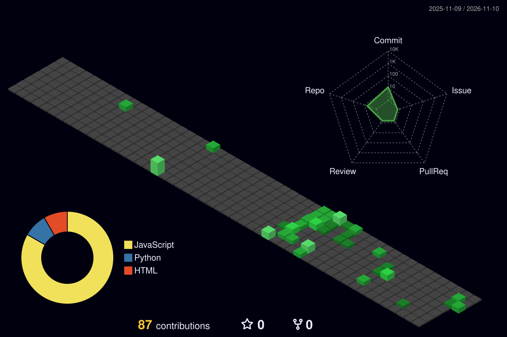

## About me

- B.Tech Computer Science, **Thapar Institute of Engineering and Technology**
- Former Software Development Intern at **Wipro**, where I built an Employee Engagement Platform with sentiment analysis
- Interested in **NLP, transformers, RAG pipelines** and shipping them inside full-stack products
- Practising **DSA in C++**
- Head of Videography, Backslash Computing Society

## Connect with me

<!-- TODO: replace YOUR-LINKEDIN-ID and YOUR-LEETCODE-ID, and add your email in the mailto link -->

## Tech stack

**Languages**

**AI / Data**

**Web and tools**

## Featured projects

| Project | What it is | Stack |
|---|---|---|
| [Astitva](https://github.com/Lakshay932/Astitva) | Responsible-AI access gate built on the NamoID identity platform ([live demo](https://astitva-gray.vercel.app)) | Python, TypeScript, Docker |
| [InvestCircle](https://github.com/AnirudhPhophalia/InvestCircle) | Peer-to-peer stock research and community platform, built as a team of four ([live demo](https://invest-circle.vercel.app/login)) | JavaScript, HTML, CSS |
| [wipro-dashboard](https://github.com/Lakshay932/wipro-dashboard) | Employee engagement dashboard from my Wipro internship | JavaScript |
| [Geometric_ques_pipeline](https://github.com/Lakshay932/Geometric_ques_pipeline) | Python pipeline for geometry question data | Python |
| [Karigar_connect](https://github.com/Lakshay932/Karigar_connect) | Web platform connecting local artisans with customers <!-- TODO: confirm --> | HTML, CSS, JavaScript |

## Currently

- Building an AI-powered QA agent and [InvestCircle](https://invest-circle.vercel.app/login), a peer-to-peer stock research platform
- Learning: <!-- TODO: add what you're learning -->
- Hackathons: <!-- TODO: add hackathons and results you want to show -->

## GitHub metrics

### Contributions calendar

### Coding habits and recent activity

